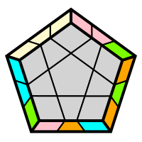
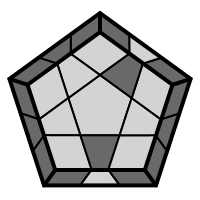
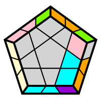
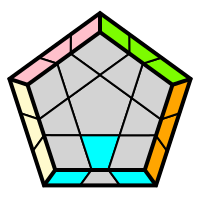
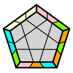
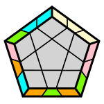
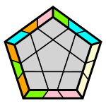
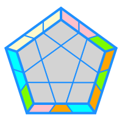
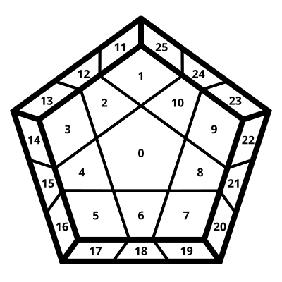

# megaminx-image

[English](README.md) | 日本語

回転記号の手順・ケース・ステッカーの色から、**メガミンクスの最後の層**（U 面と、5 つの側面の上段）の画像を作ります。
メガミンクス版の [VisualCube](http://cube.rider.biz/visualcube.php) のようなものです。Node.js でもブラウザーでも同じように動き、
**必須の依存はありません**。

<p>
  
  
  
</p>

状態の計算と描画は [Megaminx Image Editor](https://github.com/roudai/MegaminxImageEditor) のサイトから移したもので、
出力はサイトと比べてテストしています。PLL と OLL の全 410 ケースで、ステッカーの色がサイトと完全に一致します。

- **SVG** の文字列（Node.js とブラウザー、依存なし）
- ブラウザーの **canvas** への描画
- Node.js での **PNG** のバイト列（`@resvg/resvg-js` を入れたとき）
- 自分で描きたいときのための **ステッカーの色だけ**
- **PLL と OLL のケースのデータ**（410 ケース）と、手順の道具（正しい表記にする・逆にする・まとめる）
- **同じ入力なら同じ出力**：同じ入力からは、どの環境でもバイト単位で同じ SVG ができます

## インストール

```sh
npm install megaminx-image
```

Node.js 22.12 以上か、最近のブラウザーで動きます。ES モジュールだけのパッケージですが、Node.js 22.12 以上なら
`require()` でも読み込めます。

## 使い始め

```js
import { writeFileSync } from 'node:fs';
import { svg } from 'megaminx-image';

writeFileSync('case.svg', svg({ case: "R U R' U' R' F R2 U' R' U' R U R' F'" }));
```

## 画像の 3 つの作り方

| オプション | 意味 | 例 |
|---|---|---|
| `alg` | 揃った状態に手順を回したあとの状態 | `svg({ alg: "R U R' U'" })` |
| `case` | その手順で揃うケース（逆の手順を回し、手順の中の `y` の持ち替えの合計を打ち消すので、PLL の手順をそのまま渡せます） | `svg({ case: "R U R' U' R' F R2 U' R' U' R U R' F'" })` |
| `state` | 26 枚のステッカーの色を直接指定（[ステッカーの番号](#ステッカーの番号)を参照） | `svg({ state: ['u', 'u', /* … 26 色 */] })` |

使えるのはどれか 1 つだけです。どれも指定しなければ、揃った最後の層になります。

<p>
  
  
  
</p>

状態についてのほかのオプション：

- `start` — `alg` と `case` の、始めの状態を作る手順（揃った状態の代わり）。
  例：`svg({ start: "R U R'", alg: "F R U'" })`
- `rotate` — U を時計回りに `k` 回まわした向きで見せます（整数。5 で割った余りを使います）。`alg`・`case`・`state` の
  どれとも使えるので、ケースを好きな向きで見せられます：

  <p>
    
    
    
  </p>

  ```js
  svg({ case: alg, rotate: 1 });
  ```

- `stickers` — [ステッカーの番号](#ステッカーの番号)を指定して、一部の色を上書きします（`rotate` のあとに効きます）：
  `svg({ alg: 'R U', stickers: { 0: 'r', 25: '#123abc' } })`

## 記法

| 記法 | 意味 |
|---|---|
| `U F R L BR BL DR DL DBR DBL B D` | 12 の面。`X` は面 X を時計回り（その面から見て）に 72° 回します |
| `X'` | 反時計回りに 72° |
| `X2` | 時計回りに 144° |
| `X2'`, `X'2` | 反時計回りに 144° |
| `X3`, `X4`, … | 回数は 5 で割った余りで読みます（`R5` は何もしません） |
| `y` | パズル全体を U のまわりに、`U` と同じ向きに回します（`y'`・`y2` なども使えます） |
| `( … )` | まとまり。後ろに回数や `'` を付けられます：`(R U R' U')2`、`(R U)'`（逆の手順）。入れ子にもできます |

- 大文字と小文字は区別しません：`br` = `BR`、`Y` = `y`。`DFR` と `DFL` は `DR` と `DL` の別名です。
- 空白なしでも書けます（`RU2'DBR`）。コンマ・全角の空白・全角の記号（`’`、`（`、`）`、`、`）も使えます。
- WCA のスクランブルの記法（`R++ D--`）には対応していません。

読めない手順は `SyntaxError` になり、何がどこで読めなかったかを教えてくれます：

```js
svg({ alg: '(R U' });  // SyntaxError: Missing closing parenthesis (opened at position 0)
svg({ alg: 'R 2' });   // SyntaxError: Invalid move: "2" (at position 2)
svg({ alg: 'R U)' });  // SyntaxError: Unmatched ")" (at position 3)
```

### 手順の道具

```js
import { canonicalAlg, invertAlg, simplifyAlg } from 'megaminx-image';

canonicalAlg("r u bR' Y");         // "R U BR' y"
invertAlg("R U (R' F)2 BR'");      // "BR (F' R)2 U' R'"
simplifyAlg("R R' U U");           // "U2"  （括弧をまたいではまとめません）
```

## 色

色は **1 文字の色コード** か `#rrggbb` のどちらかです。`"orange"` のような色の名前は使えません。

| コード | 色 | 16 進 | | コード | 色 | 16 進 |
|---|---|---|---|---|---|---|
| `d` | 濃い灰色 | `#696969` | | `b` | 青 | `#1e90ff` |
| `u` | 薄い灰色 | `#d3d3d3` | | `y` | 黄 | `#ffff00` |
| `p` | ピンク | `#ffc0cb` | | `s` | 紫 | `#9400d3` |
| `c` | レモン | `#fffacd` | | `g` | 緑 | `#2e8b57` |
| `a` | 水色 | `#00ffff` | | `r` | 赤 | `#ff0000` |
| `o` | オレンジ | `#ffa500` | | `w` | 白 | `#ffffff` |
| `l` | ライム | `#7cfc00` | | `x` | 黒 | `#000000` |
| | | | | `z` | 黒に近い色 | `#1b1b1b` |

この表は `COLOR_CODES` として使えます。

### 配色

`scheme` で、面ごとの色を決めます。既定の配色 `DEFAULT_SCHEME` は次のとおりです：

| U | F | R | BR | BL | L | DR | DBR | B | DBL | DL | D |
|---|---|---|---|---|---|---|---|---|---|---|---|
| `u` | `a` | `o` | `l` | `p` | `c` | `s` | `y` | `b` | `r` | `g` | `w` |

自分で指定した `scheme` は、既定の配色を**置き換えます**（混ぜ合わせません）。画像に出る面に色が無いと
`TypeError` になります。

OLL の画像には `ollScheme()` を使います。U の色だけを残し、ほかの面をすべて濃い灰色にします：

```js
import { ollScheme, svg } from 'megaminx-image';

svg({ case: "L R U R' U' R' F R F' L'", scheme: ollScheme() }); // OLL 1A
svg({ case: '…', scheme: ollScheme({ U: 'y' }) }); // U を黄色に
```


## 出力

### SVG

```js
import { svg } from 'megaminx-image';

svg({ case: '…', size: 300, lineColor: '#1e90ff', background: '#ffffff' });
```

| オプション | 既定 | |
|---|---|---|
| `size` | `200` | 正方形の画像の幅と高さ（正の数ならなんでも） |
| `lineColor` | `'#000000'` | 線の色 |
| `background` | `null` | 背景の色。`null` は透明 |



線の太さは大きさに合わせて変わります（大きさ 200 で 2 と 4）。座標はすべて小数点以下 2 桁に丸め、動かすときに
三角関数を計算しないので、SVG の文字列はどの環境でも同じになります。

### canvas（ブラウザー）

```js
import { drawCanvas } from 'megaminx-image/canvas';

drawCanvas(document.querySelector('canvas'), { case: '…', size: 300 });
```

canvas の幅と高さを `size` にして、SVG と同じ画像を描きます。渡した canvas（`HTMLCanvasElement` か
`OffscreenCanvas`）だけを使います。

### PNG（Node.js）

```sh
npm install @resvg/resvg-js
```

```js
import { writeFileSync } from 'node:fs';
import { png } from 'megaminx-image/png';

writeFileSync('case.png', await png({ case: '…', size: 300 }));
```

`png()` は `Promise<Uint8Array>` を返します。`@resvg/resvg-js` は、入れなくてもよい peer dependency です。入れていないと
`png()` はインストールを促すエラーになりますが、ほかの機能はすべて使えます。

### ステッカーの色だけ

```js
import { stickerColors } from 'megaminx-image';

stickerColors({ alg: 'F' });
// ['u', 'u', 'u', 'u', 'u', 'c', 'c', 'c', 'u', 'u', 'u', 'p', 'p', 'p', 'c', 'c', 'g', 'a', 'a', 'a', 'u', 'o', 'o', 'l', 'l', 'l']
```

26 色を[ステッカーの番号](#ステッカーの番号)の順で返します。`size`・`lineColor`・`background` 以外は、`svg` と同じ
オプションを使えます。

## ステッカーの番号



頂点 0 が画像のいちばん上で、頂点は反時計回りに番号を付けます。辺 `k` は頂点 `k` と頂点 `k + 1` の間にあるので、
辺 2 がいちばん下（F 面）です。

| 番号 | ステッカー |
|---|---|
| 0 | U 面の中心 |
| 1, 3, 5, 7, 9（`1 + 2k`） | 頂点 `k` の U 面の角 |
| 2, 4, 6, 8, 10（`2 + 2k`） | 辺 `k` の U 面の辺 |
| 11–25（`11 + 3k`, `12 + 3k`, `13 + 3k`） | 辺 `k` の側面の上段：左の角・辺・右の角（外から見て） |

この並びは Megaminx Image Editor と同じで、公開の API の一部です。変えるのはメジャーバージョンを上げるときだけです。

## PLL と OLL のケース

```js
import { OLL_CASES, PLL_CASES } from 'megaminx-image/cases';
import { svg } from 'megaminx-image';

const a1 = PLL_CASES.find((c) => c.name === 'A1+');
svg({ case: a1.alg });   // ケースを、それを揃える手順から
svg({ alg: a1.setup });  // 同じ画像を、それを作る手順から
```

それぞれ `{ name, group, alg, setup }` の形で、PLL が 151 ケース、OLL が 259 ケースあります。データは
Megaminx Image Editor のものです。入口が別なので、import しなければ読み込まれません。

## エラー

間違いは、それらしく見える画像を作らずにエラーにします：

| 間違い | エラー |
|---|---|
| 読めない手順 | `SyntaxError: Invalid move: "Q" (at position 5)` |
| 知らない色 | `TypeError: Unknown color: "orange"` |
| 配色の中の知らない面 | `TypeError: Unknown face: "FR"` |
| 画像に出る面に色が無い | `TypeError: No color set for face: DR` |
| `alg` / `case` / `state` を 2 つ以上 | `TypeError: Use only one of "alg", "case" and "state"` |
| `start` と `state` を一緒に | `TypeError: "start" cannot be used with "state"` |
| オプションの名前の書き間違い | `TypeError: Unknown option: "algorithm"` |
| `state` が 26 色でない | `RangeError: "state" must have 26 colors (got 25)` |
| ステッカーの番号が範囲の外 | `RangeError: Sticker index out of range: 26 (expected 0-25)` |
| `rotate` が整数でない | `RangeError: "rotate" must be an integer (got 0.5)` |
| `size` がおかしい | `RangeError: "size" must be a positive finite number (got 0)` |

## バージョン

セマンティック バージョニングに従います。公開の API、画像の見た目（SVG の構造）、ステッカーの番号は、
メジャーバージョンを上げるときだけ変えます。

## ライセンス

[MIT](LICENSE)
