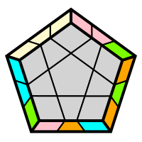
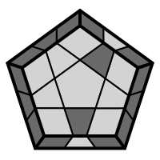
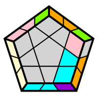
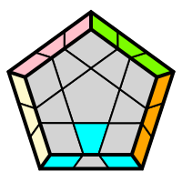
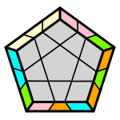
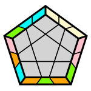
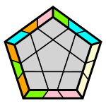
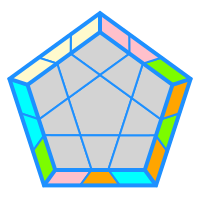
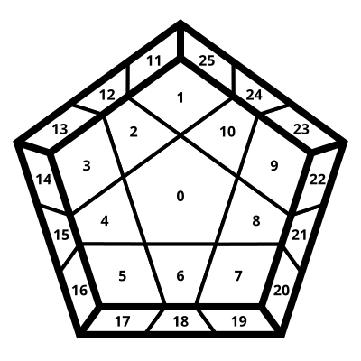

# megaminx-image

English | [日本語](https://github.com/roudai/megaminx-image/blob/main/README.ja.md)

Generate images of the **Megaminx last layer** (the U face and the top row of the five side faces) from an
algorithm, a case, or sticker colors — like [VisualCube](http://cube.rider.biz/visualcube.php), but for the
Megaminx. Works the same in Node.js and in the browser, with **no required dependencies**.

<p>
  
  
  
</p>

The state computation and drawing come from the
[Megaminx Image Editor](https://github.com/roudai/MegaminxImageEditor) website, and the output is tested
against it: for all 410 PLL and OLL cases, the sticker colors match the website exactly.

- **SVG** as a string (Node.js and browsers, no dependencies)
- **Canvas** drawing in the browser
- **PNG** bytes in Node.js (with the optional `@resvg/resvg-js`)
- **Sticker colors only**, if you want to draw them yourself
- **PLL and OLL case data** (410 cases), and algorithm tools (normalize, invert, simplify)
- **Deterministic**: the same input always gives byte-for-byte the same SVG, in every environment

## Install

```sh
npm install megaminx-image
```

Requires Node.js 22.12 or later, or any modern browser. The package is ES modules only, but it can also be
loaded with `require()` on Node.js 22.12+.

## Quick start

```js
import { writeFileSync } from 'node:fs';
import { svg } from 'megaminx-image';

writeFileSync('case.svg', svg({ case: "R U R' U' R' F R2 U' R' U' R U R' F'" }));
```

## Three ways to make an image

| Option | Meaning | Example |
|---|---|---|
| `alg` | The state after applying the algorithm to a solved puzzle | `svg({ alg: "R U R' U'" })` |
| `case` | The case that the algorithm solves (the inverse is applied, and the net `y` rotation in the algorithm is cancelled, so you can pass a PLL algorithm as it is) | `svg({ case: "R U R' U' R' F R2 U' R' U' R U R' F'" })` |
| `state` | The 26 sticker colors, given directly (see [sticker order](#sticker-order)) | `svg({ state: ['u', 'u', /* … 26 colors */] })` |

Use only one of them. With none, you get the solved last layer.

<p>
  
  
  
</p>

More options for the state:

- `start` — an algorithm that makes the starting state for `alg` and `case` (instead of a solved puzzle).
  For example `svg({ start: "R U R'", alg: "F R U'" })`.
- `rotate` — the view after turning U `k` times clockwise (an integer; taken modulo 5). It works with `alg`,
  `case` and `state`, so you can show a case from any angle:

  <p>
    
    
    
  </p>

  ```js
  svg({ case: alg, rotate: 1 });
  ```

- `stickers` — override some sticker colors by [sticker number](#sticker-order), after `rotate` is applied:
  `svg({ alg: 'R U', stickers: { 0: 'r', 25: '#123abc' } })`.

## Notation

| Notation | Meaning |
|---|---|
| `U F R L BR BL DR DL DBR DBL B D` | The 12 faces. `X` turns face X 72° clockwise (looking at that face) |
| `X'` | 72° counterclockwise |
| `X2` | 144° clockwise |
| `X2'`, `X'2` | 144° counterclockwise |
| `X3`, `X4`, … | Any count is read modulo 5 (`R5` does nothing) |
| `y` | Rotate the whole puzzle around U, in the same direction as `U` (`y'`, `y2`, … also work) |
| `( … )` | A group. A count and/or `'` may follow: `(R U R' U')2`, `(R U)'` (inverse). Groups can be nested |

- Case-insensitive: `br` = `BR`, `Y` = `y`. `DFR` and `DFL` are aliases of `DR` and `DL`.
- Moves may be written without spaces (`RU2'DBR`). Commas, ideographic spaces and full-width characters
  (`’`, `（`, `）`, `、`) are also accepted.
- WCA scramble notation (`R++ D--`) is not supported.

Unreadable algorithms throw a `SyntaxError` that tells you what and where:

```js
svg({ alg: '(R U' });  // SyntaxError: Missing closing parenthesis (opened at position 0)
svg({ alg: 'R 2' });   // SyntaxError: Invalid move: "2" (at position 2)
svg({ alg: 'R U)' });  // SyntaxError: Unmatched ")" (at position 3)
```

### Algorithm tools

```js
import { canonicalAlg, invertAlg, simplifyAlg } from 'megaminx-image';

canonicalAlg("r u bR' Y");         // "R U BR' y"
invertAlg("R U (R' F)2 BR'");      // "BR (F' R)2 U' R'"
simplifyAlg("R R' U U");           // "U2"  (never merges across parentheses)
```

## Colors

A color is either a **one-letter color code** or `#rrggbb`. Color names such as `"orange"` are not accepted.

| Code | Color | Hex | | Code | Color | Hex |
|---|---|---|---|---|---|---|
| `d` | dark gray | `#696969` | | `b` | blue | `#1e90ff` |
| `u` | light gray | `#d3d3d3` | | `y` | yellow | `#ffff00` |
| `p` | pink | `#ffc0cb` | | `s` | purple | `#9400d3` |
| `c` | lemon | `#fffacd` | | `g` | green | `#2e8b57` |
| `a` | aqua | `#00ffff` | | `r` | red | `#ff0000` |
| `o` | orange | `#ffa500` | | `w` | white | `#ffffff` |
| `l` | lime | `#7cfc00` | | `x` | black | `#000000` |
| | | | | `z` | near black | `#1b1b1b` |

The table is exported as `COLOR_CODES`.

### Color schemes

`scheme` maps faces to colors. The default, `DEFAULT_SCHEME`, is:

| U | F | R | BR | BL | L | DR | DBR | B | DBL | DL | D |
|---|---|---|---|---|---|---|---|---|---|---|---|
| `u` | `a` | `o` | `l` | `p` | `c` | `s` | `y` | `b` | `r` | `g` | `w` |

A custom `scheme` **replaces** the default (it is not merged). If a face shown in the image has no color, a
`TypeError` is thrown.

For OLL images, `ollScheme()` keeps only the U color and makes every other face dark gray:

```js
import { ollScheme, svg } from 'megaminx-image';

svg({ case: "L R U R' U' R' F R F' L'", scheme: ollScheme() }); // OLL 1A
svg({ case: '…', scheme: ollScheme({ U: 'y' }) }); // yellow U
```


## Output

### SVG

```js
import { svg } from 'megaminx-image';

svg({ case: '…', size: 300, lineColor: '#1e90ff', background: '#ffffff' });
```

| Option | Default | |
|---|---|---|
| `size` | `200` | Width and height of the square image (any positive number) |
| `lineColor` | `'#000000'` | Color of the lines |
| `background` | `null` | Background color; `null` is transparent |



Line widths scale with the size (2 and 4 at size 200). All coordinates are rounded to two decimal places,
and no trigonometry is computed at run time, so the SVG string is identical in every environment.

### Canvas (browser)

```js
import { drawCanvas } from 'megaminx-image/canvas';

drawCanvas(document.querySelector('canvas'), { case: '…', size: 300 });
```

Sets the canvas width and height to `size` and draws the same image as the SVG. It only uses the canvas you
pass (an `HTMLCanvasElement` or an `OffscreenCanvas`).

### PNG (Node.js)

```sh
npm install @resvg/resvg-js
```

```js
import { writeFileSync } from 'node:fs';
import { png } from 'megaminx-image/png';

writeFileSync('case.png', await png({ case: '…', size: 300 }));
```

`png()` returns a `Promise<Uint8Array>`. `@resvg/resvg-js` is an optional peer dependency; without it,
`png()` throws an error that tells you to install it, and everything else still works.

### Sticker colors only

```js
import { stickerColors } from 'megaminx-image';

stickerColors({ alg: 'F' });
// ['u', 'u', 'u', 'u', 'u', 'c', 'c', 'c', 'u', 'u', 'u', 'p', 'p', 'p', 'c', 'c', 'g', 'a', 'a', 'a', 'u', 'o', 'o', 'l', 'l', 'l']
```

Returns the 26 colors in [sticker order](#sticker-order). It takes the same options as `svg` except
`size`, `lineColor` and `background`.

## Sticker order



Vertex 0 is at the top of the image, and the vertices are numbered counterclockwise. Edge `k` is between
vertex `k` and vertex `k + 1`, so edge 2 is at the bottom (the F face).

| Number | Sticker |
|---|---|
| 0 | U center |
| 1, 3, 5, 7, 9 (`1 + 2k`) | U corner at vertex `k` |
| 2, 4, 6, 8, 10 (`2 + 2k`) | U edge at edge `k` |
| 11–25 (`11 + 3k`, `12 + 3k`, `13 + 3k`) | Top row of the side face at edge `k`: left corner, edge, right corner (seen from outside) |

This order is the same as the Megaminx Image Editor, and it is part of the public API: it will only change
in a major version.

## PLL and OLL cases

```js
import { OLL_CASES, PLL_CASES } from 'megaminx-image/cases';
import { svg } from 'megaminx-image';

const a1 = PLL_CASES.find((c) => c.name === 'A1+');
svg({ case: a1.alg });   // the case, from the algorithm that solves it
svg({ alg: a1.setup });  // the same image, from the algorithm that sets it up
```

Each entry is `{ name, group, alg, setup }`: 151 PLL cases and 259 OLL cases, from the Megaminx Image Editor.
This is a separate entry point, so it is not loaded unless you import it.

## Errors

Mistakes throw instead of producing a plausible-looking image:

| Mistake | Error |
|---|---|
| Unreadable algorithm | `SyntaxError: Invalid move: "Q" (at position 5)` |
| Unknown color | `TypeError: Unknown color: "orange"` |
| Unknown face in a scheme | `TypeError: Unknown face: "FR"` |
| A face in the image has no color | `TypeError: No color set for face: DR` |
| More than one of `alg` / `case` / `state` | `TypeError: Use only one of "alg", "case" and "state"` |
| `start` with `state` | `TypeError: "start" cannot be used with "state"` |
| Misspelled option | `TypeError: Unknown option: "algorithm"` |
| `state` without 26 colors | `RangeError: "state" must have 26 colors (got 25)` |
| Sticker number out of range | `RangeError: Sticker index out of range: 26 (expected 0-25)` |
| Non-integer `rotate` | `RangeError: "rotate" must be an integer (got 0.5)` |
| Bad `size` | `RangeError: "size" must be a positive finite number (got 0)` |

## Versioning

This package follows semantic versioning. The public API, the look of the image (the SVG structure), and the
sticker order only change in a major version.

## License

[MIT](LICENSE)
